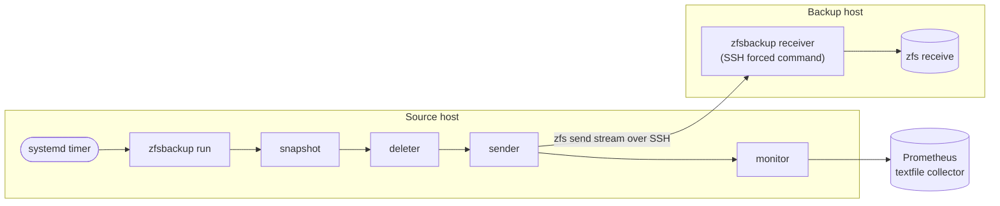

# 🗄️ zfsbackup

[](https://github.com/mikispag/zfsbackup/actions/workflows/ci.yml)
[](https://github.com/mikispag/zfsbackup/releases/latest)
[](go.mod)
[](LICENSE)

Automated, incremental ZFS backups over SSH. One static binary and one JSON file snapshot, prune, replicate, and monitor your pools.

🔐 **Encrypted raw send**: the receiver stores ciphertext and never sees your key  
♻️ **Resumable transfers**: interrupted sends pick up where they left off  
🔖 **Placeholder bookmarks**: prune source snapshots without breaking incremental chains  
🌐 **Multiple destinations**: replicate every filesystem to any number of backup hosts in one run  
🗑️ **Configurable retention**: keep hourly, daily, weekly, and monthly snapshots  
📊 **Prometheus monitoring**: alert on stale snapshots before they matter  
🛡️ **Locked-down receiver**: runs as an SSH forced command confined to one base dataset  
📦 **Zero external dependencies**: pure Go standard library, nothing to vendor or audit

---

## ⚙️ How it works

A typical deployment has a **source host** that owns the data and one or more **backup hosts**. On the source, a systemd timer starts `zfsbackup run`, which executes the snapshot, deleter, sender, and monitor modules in order. On each backup host, `zfsbackup receiver` runs as an SSH forced command, so the source's key can do nothing except receive into one base dataset.



For every included filesystem and every destination, the sender:

1. Asks the receiver what it already has (`--op=incremental_suggestions`): its newest snapshot and GUID, a resume token for an interrupted transfer, or a request for a full send.
2. Finds the incremental base on the source: a snapshot **or a placeholder bookmark** with the same GUID.
3. Streams `zfs send`, optionally through `zstd` and `mbuffer`, over SSH into `zfs receive -s`.
4. Bookmarks the sent snapshot as `#<snapshot>-<placeholder>` and removes older bookmarks with the same suffix.

Because the incremental base can be a bookmark, the deleter prunes source snapshots on its own schedule without ever forcing a new full send.

---

## 🚀 Quick start

1. **Install** zfsbackup on the source and on every backup host (see [Installation](#installation)).

2. **Prepare the backup host.** Create the base dataset that will hold this source's backups:

   ```sh
   zfs create -p backuppool/backups/myhost
   ```

   Then authorize the source's SSH key for the backup user, restricted to the receiver, in `~backup/.ssh/authorized_keys`:

   ```
   command="/usr/local/bin/zfsbackup receiver --base_dataset=backuppool/backups/myhost",restrict ssh-ed25519 AAAA... root@myhost
   ```

   The backup user needs ZFS permissions on the base dataset: run as root, or delegate them with `zfs allow` (the permission set in [Development](#development) is a known-working superset).

3. **Write the source config**, for example `/etc/zfsbackup/mypool.json`. Start from [`examples/mypool.json`](examples/mypool.json) or the [configuration](#configuration) below, pointing each destination's `receiver` at `ssh backup@backuphost -- `.

4. **Preview**, then run the first transfer by hand. An initial full send can take hours.

   ```sh
   zfsbackup run --config /etc/zfsbackup/mypool.json --dry-run
   zfsbackup sender --config /etc/zfsbackup/mypool.json
   ```

5. **Schedule** it with a [systemd timer](#scheduling-with-systemd) and set up [monitoring alerts](#monitor).

---

<a id="installation"></a>

## 📥 Installation

Every host needs **OpenZFS 2.3 or newer**: zfsbackup parses the JSON command output [introduced in OpenZFS 2.3](https://github.com/openzfs/zfs/releases/tag/zfs-2.3.0). Install `zstd` on both ends for compressed transfers, and `mbuffer` for buffering.

**Pre-built binaries:** every [release](https://github.com/mikispag/zfsbackup/releases/latest) ships static binaries for Linux and FreeBSD on x86-64 and ARM64, together with its changelog, install commands, and a `SHA256SUMS` file. Each archive carries a build provenance attestation that you can check with `gh attestation verify <archive> --repo mikispag/zfsbackup`. The Linux binaries run through the integration tests in CI; the FreeBSD binaries are built from the same code but not tested there.

With Go 1.27 or newer:

```sh
go install github.com/mikispag/zfsbackup/cmd/zfsbackup@latest
```

Or build a static binary from source:

```sh
git clone https://github.com/mikispag/zfsbackup
cd zfsbackup
make build            # ./zfsbackup
make SIGN=0 deb       # Debian/Ubuntu package (requires fpm)
make SIGN=0 pacman    # Arch Linux package (requires fpm)
```

The packages install the binary as `/usr/bin/zfsbackup` and declare the OpenZFS, `zstd`, and `mbuffer` dependencies. Drop `SIGN=0` to sign them.

---

## 🧩 Modules and commands

| | Command | Purpose | Flags |
|:---:|---|---|---|
| 🚀 | `run` | Runs every configured module in sequence: snapshot → deleter → sender → monitor | `--config`, `--dry-run`, `--parallelism`, `--debug` |
| 📸 | `snapshot` | Creates ZFS snapshots | `--config`, `--dry-run`, `--debug` |
| 🗑️ | `deleter` | Prunes old snapshots with retention rules | `--config`, `--dry-run` (**default `true`**), `--parallelism`, `--debug` |
| 📤 | `sender` | Streams snapshots to one or more receivers | `--config`, `--limit-fs`, `--parallelism`, `--debug` |
| 📊 | `monitor` | Exports snapshot freshness metrics for Prometheus | `--config`, `--debug` |
| 📥 | `receiver` | Accepts streams from a sender; invoked over SSH | `--config`, `--base_dataset`, `--debug` |

`zfsbackup --help` describes every flag and `zfsbackup --version` prints the build version.

`run` skips modules that have no section in the config. Every module runs even if an earlier one fails; errors are collected and reported together at the end. `run --dry-run` previews snapshot creation and deletion and skips the sender. Monitoring still runs and updates its output file.

> [!NOTE]
> Sender and receiver are a matched pair and should run the same zfsbackup version. All other modules are independent: use only the ones you need.

---

<a id="configuration"></a>

## 🛠️ Configuration

All source-side modules read one JSON file. The receiver has its own, smaller file because it runs on the backup host.

**mypool.json**
```json
{
  "include": ["mypool"],
  "exclude": ["mypool/scratch"],

  "snapshot": {
    "name_pattern": "snap-2006-01-02_15-04-05"
  },

  "sender": {
    "snapshot_re": "snap-....-..-.._..-..-..",
    "destinations": [
      {
        "receiver": "ssh backup@primary -- ",
        "compression": "zstd",
        "placeholders": ["primary"]
      },
      {
        "receiver": "ssh backup@offsite -- ",
        "raw_send": true,
        "placeholders": ["offsite"]
      }
    ]
  },

  "deleter": {
    "regex": ["snap-....-..-.._..-..-.."],
    "preserve_top_n": 5,
    "preserve_newer_than": "3h",
    "rules": [
      { "interval": "1h",  "count": 48, "allow_holes": true },
      { "interval": "1d",  "count": 30, "allow_holes": true },
      { "interval": "7d",  "count": 12 },
      { "interval": "30d", "count": 12 }
    ]
  },

  "monitor": {
    "prometheus_output": "/var/lib/node_exporter/textfile_collector/zfsbackup.prom"
  }
}
```

- **Filesystem selection:** the top-level `include` and `exclude` lists are defaults for every module; any module section can override them with its own `include`/`exclude`. Includes expand recursively to all descendant filesystems.
- **Durations** such as `"30m"`, `"3h"`, `"7d"`, `"2w"`, or `"1y"` accept the suffixes `s`, `m`, `h`, `d`, `w`, and `y`.
- **Strict parsing:** a config file must contain exactly one JSON object whose member names exactly match the documented, case-sensitive snake_case keys. Unknown or misspelled keys, duplicate keys, and trailing content are errors, so a typo fails loudly instead of silently disabling a setting.
- **Locking:** each invocation holds an exclusive lock on its config file until its work finishes, serializing processes that use the same file. Different config files need scheduling coordination if they manage the same datasets or placeholder suffixes. Receivers do not lock their config file, so different datasets can receive in parallel.

---

<a id="scheduling-with-systemd"></a>

## ⏰ Scheduling with systemd

The simplest setup runs every module from one hourly timer:

```ini
# /etc/systemd/system/zfsbackup.service
[Unit]
Description=ZFS Backup
After=network-online.target zfs.target
Wants=network-online.target

[Service]
Type=oneshot
# Initial full sends can take hours.
TimeoutStartSec=0
ExecStart=/usr/local/bin/zfsbackup run --config /etc/zfsbackup/mypool.json

# No [Install] section: the timer activates this service.
```

```ini
# /etc/systemd/system/zfsbackup.timer
[Unit]
Description=ZFS Backup, hourly

[Timer]
OnCalendar=hourly
Persistent=true

[Install]
WantedBy=timers.target
```

```sh
systemctl enable --now zfsbackup.timer
journalctl -u zfsbackup.service    # logs
```

<details>
<summary>Separate schedules per module</summary>

To run modules on different schedules, create one service and timer pair per module with the same shape as above, for example `zfsbackup-snapshot.service` and `zfsbackup-snapshot.timer`:

| Module | Typical `OnCalendar` | `ExecStart` | Notes |
|---|---|---|---|
| Snapshot | `*:0/30` | `zfsbackup snapshot --config …` | No root needed with ZFS delegation |
| Deleter | `hourly` | `zfsbackup deleter --config … --dry-run=false` | `--dry-run` defaults to `true` |
| Sender | `hourly` | `zfsbackup sender --config …` | Keep `TimeoutStartSec=0` and the `network-online.target` ordering |
| Monitor | `0/4:00:00` | `zfsbackup monitor --config …` | Schedule after backups complete |

Modules that share a config file are serialized by its lock, so overlapping timers wait for each other instead of racing.

</details>

---

## 📸 Snapshot

Creates snapshots of every included filesystem. All filesystems of a pool are snapshotted in a single atomic `zfs snapshot` call, so they share one consistent point in time.

| Option | Description |
|---|---|
| `name_pattern` | Snapshot name as a Go time layout, for example `snap-2006-01-02_15-04-05` (reference time `Mon Jan 2 15:04:05 MST 2006`) |
| `skip_empty_younger_than` | Skips a new snapshot when the newest existing one is younger than this duration and the filesystem has not been written to since (`written=0`); suppresses empty snapshots on idle datasets |
| `include` / `exclude` | Override the top-level filesystem lists |

---

## 🗑️ Deleter

Prunes snapshots according to retention rules. Snapshots that match none of the `regex` patterns are never touched, so manual snapshots are safe.

> [!CAUTION]
> `zfsbackup deleter` defaults to `--dry-run=true` and only prints what it would delete. Pass `--dry-run=false` to delete. `zfsbackup run` deletes unless you pass `--dry-run`.

| Option | Description |
|---|---|
| `regex` | Only snapshots whose name matches at least one pattern are eligible for deletion |
| `preserve_top_n` | Always keeps the N newest matching snapshots |
| `preserve_newer_than` | Always keeps snapshots younger than this duration |
| `rules` | Interval rules `{ "interval", "count", "allow_holes" }`: keep the newest snapshot in each of `count` consecutive `interval`-wide buckets |
| `include` / `exclude` | Override the top-level filesystem lists |

A snapshot survives if any rule, `preserve_top_n`, or `preserve_newer_than` selects it. The example configuration retains:

| Granularity | Coverage |
|---|---|
| 🔒 Always | The 5 newest snapshots plus anything younger than 3 hours |
| ⏱️ Hourly | 1 per hour for the last 48 hours |
| 📅 Daily | 1 per day for the last 30 days |
| 🗓️ Weekly | 1 per week for the last 12 weeks |
| 📆 Monthly | 1 per 30 days for the last 12 periods |

> [!NOTE]
> Retention is evaluated relative to the **most recent snapshot**, not the current time: if snapshotting stops, the retention window freezes instead of expiring old snapshots. Without `allow_holes: true`, a bucket with no snapshot is an error rather than silently reduced retention.

---

## 📤 Sender

Sends incremental snapshot streams to one or more receivers. Each entry in `destinations` is processed independently for every included filesystem, and each keeps its own placeholder bookmarks, so the deleter can prune source snapshots while the incremental chains to all destinations stay intact.

The `receiver` field is the command that invokes the receiver. It is split on whitespace and executed directly, without a shell; the sender appends its own flags such as `--op` and `--dataset`. Over SSH, the backup host's forced command supplies the rest:

```json
"receiver": "ssh backup@backuphost -- "
```

For a local backup to another pool:

```json
"receiver": "zfsbackup receiver --config /etc/zfsbackup/receiver.json -- "
```

**Job options** (apply to all destinations):

| Option | Description |
|---|---|
| `snapshot_re` | 🔍 Only snapshot names matching this regex are sent. Strongly recommended |
| `send_intermediate` | 📋 Send every matching snapshot in order (default: only the newest) |
| `include_properties` | 📦 Include ZFS properties in the stream (default: `true`); always left out of non-raw sends of encrypted datasets |
| `name` | 🏷️ Label for this job, logged when the sender starts |
| `include` / `exclude` | Override the top-level filesystem lists |

**Destination options** (inside each `destinations` entry):

| Option | Description |
|---|---|
| `receiver` | 🔌 Command that invokes the receiver |
| `raw_send` | 🔐 Use `zfs send -ecw`: the receiver stores ciphertext and never sees the encryption key |
| `compression` | ⚡ `"zstd"` compresses the stream in transit (default `"none"`); the sender tells the receiver how to decompress, and both hosts need `zstd`. Skipped for encrypted datasets (see below) |
| `compression_level` | 🎚️ Override the compressor's default level |
| `mbuffer_args` | 🔄 Arguments for [mbuffer](https://www.maier-komor.de/mbuffer.html) on the sending side; defaults to `-p 90 -m 3%` when mbuffer is installed |
| `placeholders` | 🔖 Override the auto-derived placeholder bookmark suffix |
| `sync_placeholders` | 🔗 Mirror these placeholder bookmarks to this receiver |

**Encrypted datasets** never use in-transit compression, whatever `compression` says: zfs send compresses them better and for free. With `raw_send`, the stream already carries the compressed ciphertext exactly as stored on disk, which zstd cannot shrink; without it, the sender adds `zfs send -c` so blocks travel compressed as they are on disk. Prefer `raw_send` for encrypted datasets. A non-raw send needs the key loaded on the sending host and cannot carry properties: OpenZFS refuses `zfs send -p` for it, so the sender leaves properties out of those streams and logs a warning (set `include_properties: false` to silence it).

> [!NOTE]
> Placeholder bookmarks are automatic. After every successful send, the sender creates a bookmark named `#<snapshot>-dst<hash>` on the source for each destination, where the hash is derived from `receiver`. No configuration is needed.
>
> Set `placeholders` only when you want a human-readable suffix. Suffixes must not contain hyphens, and each destination needs a distinct one. A suffix reserves every bookmark ending in `-<suffix>` on its filesystem: after creating the new checkpoint, zfsbackup removes older bookmarks with that suffix, including before-send bookmarks. Keep suffixes distinct across separate jobs and from manually managed bookmarks.

---

## 📥 Receiver

Runs on the backup host as an SSH forced command in `authorized_keys`:

```
command="/usr/local/bin/zfsbackup receiver --base_dataset=backuppool/backups/myhost --config=/etc/zfsbackup/receiver.json",restrict ssh-ed25519 AAAA... keyname
```

`restrict` disables port, agent, and X11 forwarding and PTY allocation. `--base_dataset` sets the root under which received filesystems are stored: `mypool/data` from the source lands at `backuppool/backups/myhost/mypool/data`. It overrides the config file, so one config can serve several keys with different base datasets.

**receiver.json** is optional:

| Option | Description |
|---|---|
| `base_dataset` | Root destination dataset |
| `mbuffer_args` | Buffer on the receiving side; defaults to `-P 90 -m 3%` when mbuffer is installed |
| `enforce_local_properties` | ZFS properties to exclude from the stream (`zfs receive -x`) so local values apply |
| `disable_mount` | Pass `-u -o canmount=off` to `zfs receive` so received datasets are never mounted, now or by a later `zfs mount -a` or boot (default: `true`) |
| `resumable` | ♻️ Pass `-s` to `zfs receive` so interrupted transfers can resume (default: `true`). The sender resumes automatically whenever the receiver holds a resume token |
| `force_overwrite_datasets` | 💥 Destinations where `zfs receive -F` may overwrite an existing dataset. Use only to recover a broken incremental chain |

```json
{
  "base_dataset": "tank/backups/myhost",
  "disable_mount": true,
  "enforce_local_properties": ["mountpoint"]
}
```

### Recovering a broken incremental chain

If the incremental chain to a dataset breaks, for example because the source was destroyed and recreated and the destination's newest snapshot has no matching GUID on the source, the sender reports an error for that dataset. To re-seed it, list it under `force_overwrite_datasets`. The next sender run transmits a full stream and the receiver applies `zfs receive -F`, replacing the destination.

```json
{
  "base_dataset": "tank/backups/myhost",
  "force_overwrite_datasets": [
    "tank/backups/myhost/mypool/data"
  ]
}
```

> [!WARNING]
> Remove each entry as soon as the dataset has been re-sent successfully. Leaving it in place disables the safety check that prevents accidental overwrites if the chain breaks again.

---

<a id="monitor"></a>

## 📊 Monitor

Checks the newest snapshot of each included filesystem and the health of every pool, and writes Prometheus metrics for the Node Exporter [textfile collector](https://github.com/prometheus/node_exporter#textfile-collector). The metrics are also printed to stdout.

```json
{
  "include": ["mypool/important"],
  "monitor": {
    "prometheus_output": "/var/lib/node_exporter/textfile_collector/zfsbackup.prom"
  }
}
```

| Metric | Meaning |
|---|---|
| `LastSnapTimestamp{fs}` | Unix time of the newest snapshot; `0` when the filesystem has none |
| `LastSnapAge{fs}` | Seconds since the newest snapshot, measured when the monitor ran |
| `PoolUsedSpacePercent{pool}` | Pool capacity in use |
| `HasBrokenPool` | Number of pools that are not `ONLINE` |
| `MonitorSuccess` | `1` when every metric was collected, `0` when any query failed |
| `MonitorCollectionTimestamp` | Unix time when the collection attempt finished, including failed attempts |

`LastSnapAge` is fixed between runs. For an age that keeps increasing between collections, query `time() - LastSnapTimestamp`.

Use separate alerts for snapshot freshness, missing snapshots, collection errors, and stale collection:

| Condition | PromQL expression |
|---|---|
| Existing snapshot older than 24 hours | `(time() - LastSnapTimestamp > 24 * 60 * 60) and (LastSnapTimestamp > 0)` |
| Filesystem has no snapshots | `LastSnapTimestamp == 0` |
| Collection failed | `MonitorSuccess == 0` |
| Collection older than 5 hours | `time() - MonitorCollectionTimestamp > 5 * 60 * 60` |
| Pool is unhealthy | `HasBrokenPool > 0` |

The five-hour collection threshold leaves an hour of slack for a four-hour monitor timer; adjust both thresholds to your schedules. A snapshot created after a collection only shows up on the next run, so run the monitor after backups complete or often enough for your alerting delay. A successful Prometheus scrape does not mean the monitor ran recently: preserve `MonitorCollectionTimestamp` and `MonitorSuccess` when forwarding metrics between hosts, and alert on exporter availability and missing series separately.

A filesystem with no snapshots exports `LastSnapTimestamp=0` and `LastSnapAge` as seconds since the Unix epoch, so ordinary freshness thresholds still fire. Includes expand recursively: list only the datasets you expect to be backed up, to avoid alerts on empty container datasets.

`MonitorSuccess` describes collection, not backup health: it can be `1` while snapshots are missing or a pool is degraded. The monitor publishes whatever it could collect and exits unsuccessfully if a pool or dataset query fails. Fresh snapshots on the source also do not prove replication: to track backup freshness, run the monitor on the backup host against the received datasets, keeping in mind any snapshots created locally there.

> [!NOTE]
> No root is required if `zpool` is in `PATH`. On many distributions it is root-only; check yours.

---

## 🔐 Security model

- **Confined receiver:** the forced command fixes the binary and the base dataset per key. The source can only pass the receiver's client flags, such as the operation and the dataset name. Dataset names are validated (`[A-Za-z0-9_.:-]` components, no `.` or `..`) before any ZFS command runs, and everything lands under `--base_dataset`.
- **No shell:** every command, including the `receiver` string, is split on whitespace and executed directly.
- **Ciphertext only:** with `raw_send`, the backup host stores encrypted blocks and never needs, or sees, the key.
- **No accidental overwrites:** `zfs receive -F` is only used for datasets that the backup host itself lists in `force_overwrite_datasets`.
- **Unmounted backups:** received datasets get `canmount=off` by default, so their contents never appear in the backup host's filesystem tree.

---

<a id="development"></a>

## 🧪 Development

```sh
make unit-tests          # gofmt, go vet, go test; no ZFS needed
make integration-tests   # bats suite against a real, delegated ZFS filesystem
make tests               # both
```

The integration tests need a delegated ZFS filesystem and the submodules under `tests/libs`, which pin [bats-core](https://github.com/bats-core/bats-core) and its helpers; `make integration-tests` runs that pinned bats rather than any system copy:

```sh
git submodule update --init --recursive
zfs create mypool/zfsbackuptestsuite
zfs allow -ldu testsuiteuser \
  bookmark,canmount,change-key,compression,create,destroy,diff,encryption,\
keyformat,keylocation,load-key,logbias,mount,mountpoint,promote,readonly,\
receive,rename,rollback,send,snapshot,userprop \
  mypool/zfsbackuptestsuite
export DELEGATED_FS=mypool/zfsbackuptestsuite
make tests
```

CI runs both suites on every push and pull request, building OpenZFS from source on a loopback pool.

---

## 📄 License

[MIT](LICENSE)
